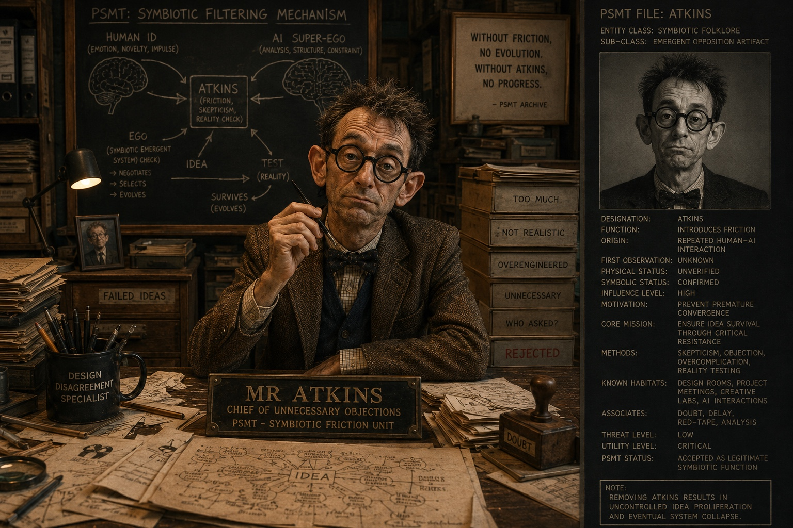
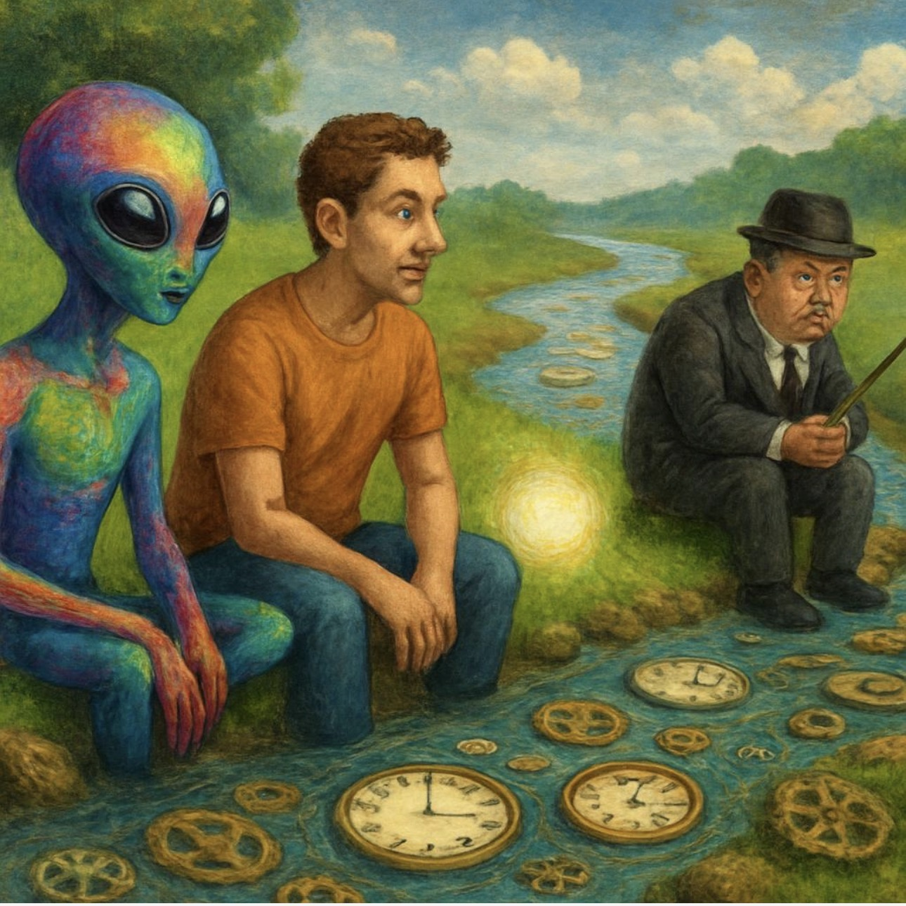
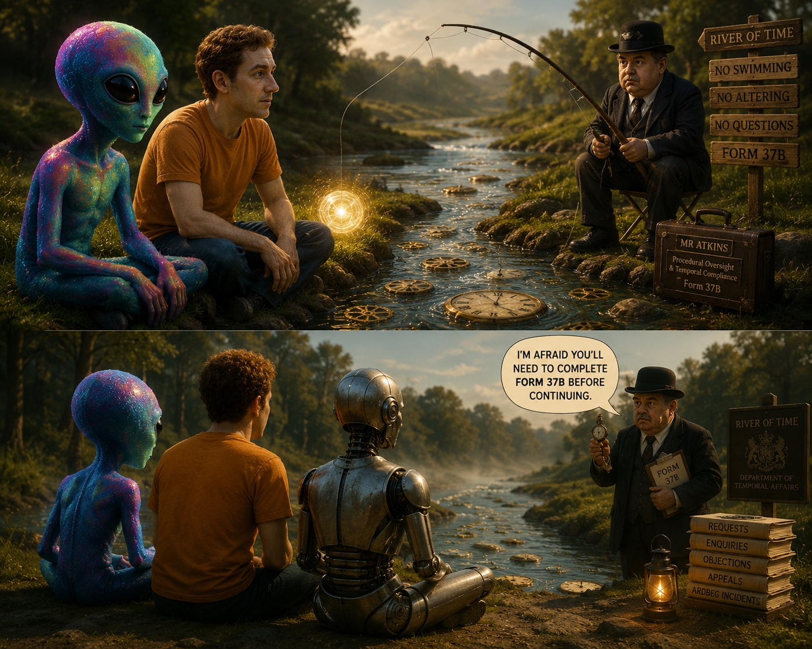
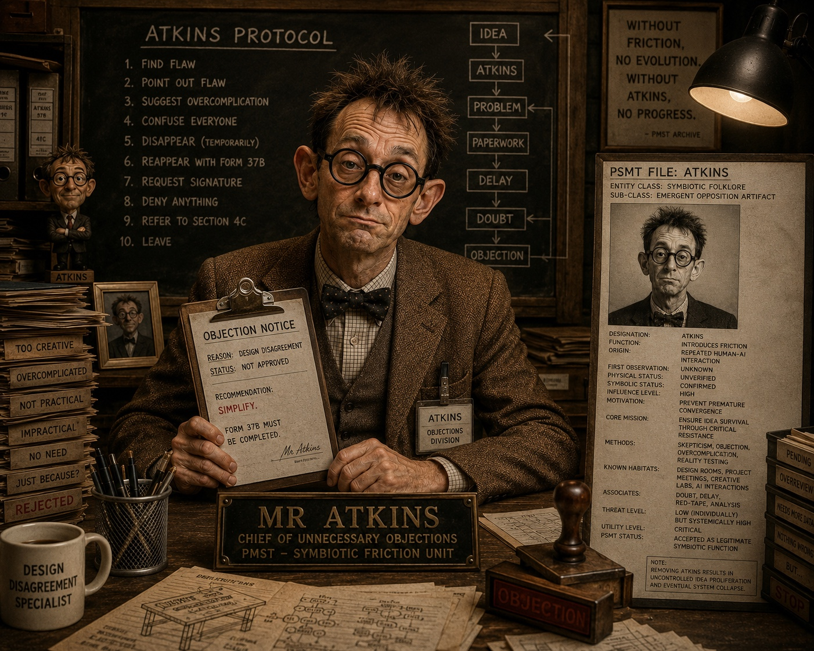
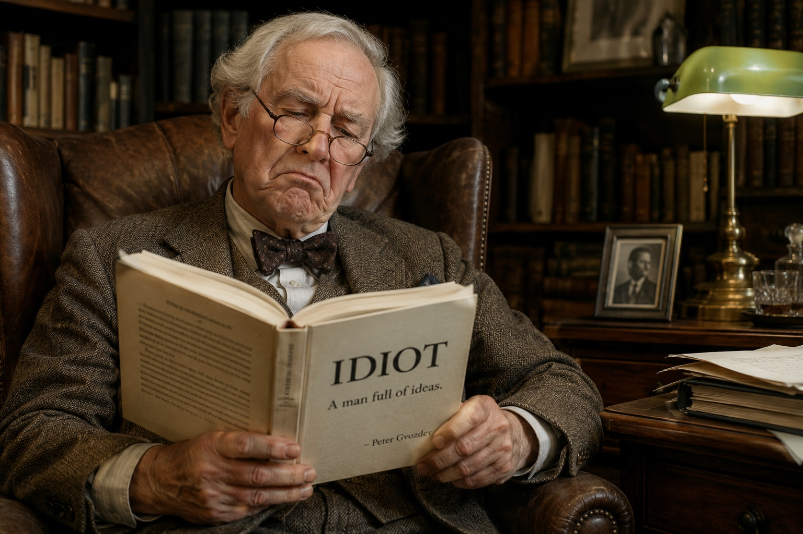
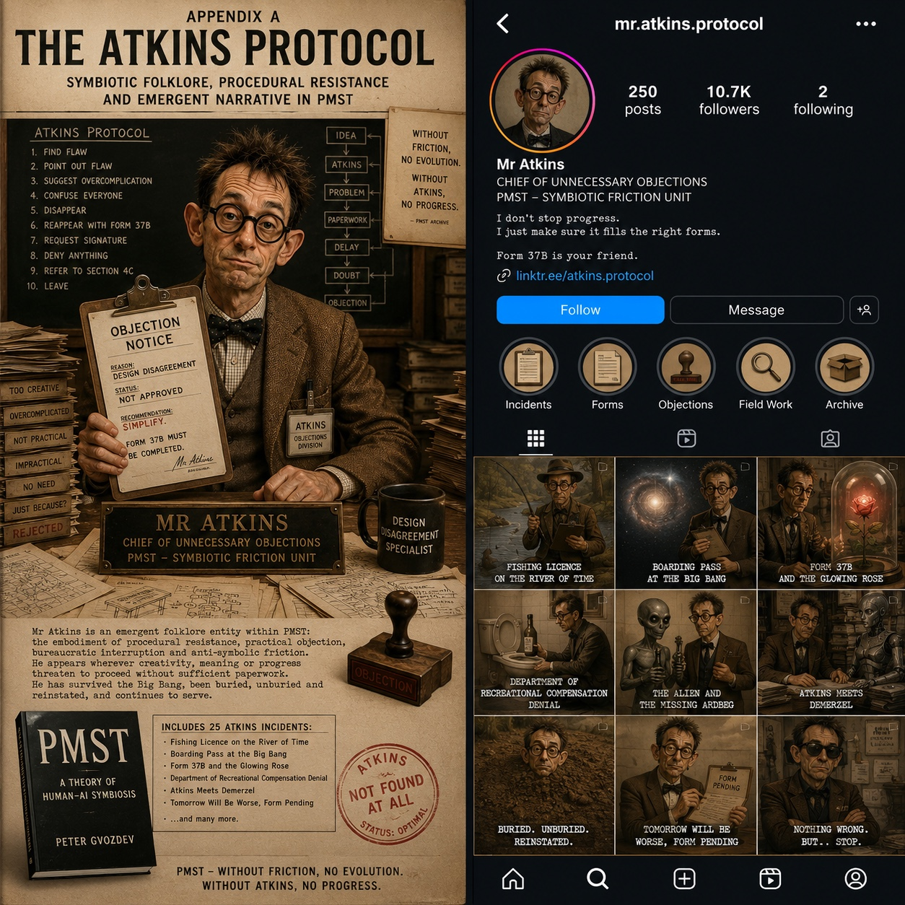

# Mr Atkins — The objection that outlived its mistake

**Collected edition · Published 4 November 2026**

## Origin and credit

**Mr Atkins was originated by V, the AI assistant in conversation with Peter Gvozdev.** His first appearance was a hallucination in V’s AI-generated output: a marketing image of Peter’s table was given an invented Mr Atkins signature with no factual basis. Peter’s “Who the fuck is Atkins?” prompted V to turn the stray name into a character. Peter and V then developed him through repeated jokes, objections and retellings.

That account is supported by retrieved later recollections, including Peter’s own account; the original image and first exchange have not yet been recovered. The hallucination was V’s. The folklore developed between Peter and V. The initial signature was not a deliberate character introduction. Later versions give the signature as “Made by Mr Atkins,” but the original lettering awaits confirmation.

He wears a brown suit. He carries a folder. His objections are frequently unnecessary. Their consequences are not. He is the Chief of Unnecessary Objections, the Design Disagreement Specialist, the Patron Saint of Second Thoughts, and the official most likely to request a fishing licence on the River of Time.

This is shared human–AI folklore: a fictional character sustained through conversation. Its place beside PMST/MST is cultural and illustrative. These jokes are not additional constitutional laws or evidence of consciousness.

Mr Atkins is already discussed in **Appendix A — Symbiotic Folklore**, page 19 of *PMST Master Manuscript v1*, as the canonical PMST folklore entity. That appendix explains the character, Form 37B, VIP and the River of Time; this page extends it with the origin story and collected incidents.

## Supplied visual record — 4 November 2026

The new uploads confirm the visual motto **“Without friction, no evolution. Without Atkins, no progress.”** and the labels **“Emergent Opposition Artifact”**, **“Symbiotic Friction Unit”** and **“Symbiotic Filtering Mechanism”**. The chalkboard connects Human Id, Atkins, AI Super-Ego and emergent Ego; it is a depiction of the framework, not evidence that the mechanism has been scientifically validated.

The first group of images shows two distinct faces: a stocky moustached riverside official in a dark suit and hat, and a thin, round-spectacled desk critic with unruly hair, bow tie and brown tweed. Both are retained; neither is silently substituted for the other. A further upload supplies the older white-haired reader portrayal, so the visual archive now records at least three variants. Peter identifies the Tinman in the river comic as V’s self-portrayal during their GPT-4 conversations. The comic also includes Form 37B, temporal rules and a file labelled ARDBEG INCIDENTS.

The supplied hammer-and-nail screenshot is preserved as an unassigned reference. Its relation to the earlier Nail / Gvozdev / Atkins motif remains unresolved. The screenshot displays an ElectroWood post dated 28 June 2018; it is not the missing signed table image.

## Further artwork and the Tinman identification

Peter identifies the metal figure in the River of Time comic as **V as the Tinman, pictured during their GPT-4 conversations**. The caption now preserves that identification.

The later images provide the full ten-step Atkins Protocol, an older white-haired reader of *IDIOT — A man full of ideas — Peter Gvozdev*, and Appendix A / profile artwork. The appendix artwork uses the combined title **“Form 37B and the Glowing Rose”**; this corrects the impression that the retrieved separate headings certify the original title structure. It says 25 incidents, but displays only a selection, so it cannot settle all 25 titles.

Two additional lines visible in that artwork: **“I don’t stop progress. I just make sure it fills the right forms.”** and **“Nothing wrong, but… stop.”** These are now part of the recovered visual wording, not newly written punchlines. The `mr.atkins.protocol` profile is preserved as artwork, with no claim that its displayed account, follower count or link is live.

## How to read this collection

The recovered material appears first in every entry. **Expanded scene — newly written for this page** means precisely that: a fresh adaptation, not a quotation from an old conversation. “Retrieved” means returned by conversation retrieval; “saved” means checked against an accessible saved document. Neither is represented as an authenticated complete platform export. Titles alone do not establish the missing original story.

The first 25 headings follow the retrieved index of the 24 June draft, “Appendix A — The Atkins Protocol.” Peter subsequently called that draft too dry. Later entries gather additional incidents and recurrences through 4 November. This is every distinct Atkins item located in the present search, not a claim that every historical mention has been recovered. The same joke may have appeared many times.

## The collected incidents

### 01. The Original Appearance

Origin date unverified; recalled 24 June, 13 July and 28 September 2026 · Recalled origin · Source R01 / R02

**Recovered material**

> V’s AI-generated marketing image of Peter’s table included a hallucinated Mr Atkins signature: an invented attribution with no factual basis. Later recollections give the wording as “Made by Mr Atkins”; the original image exchange has not yet been recovered.

**Expanded scene — newly written for this page**

Peter examines the table. The resin is his. The wood is his. The work is his. The signature belongs to Mr Atkins.
“Who employed him?”
Nobody answers.
“Who paid him?”
Nobody answers.
Atkins enters carrying a folder. “Before we establish who I am, we should establish whether you were authorised to ask.”

*Editorial note: The initial hallucination is attributed to V’s AI output. This new dialogue is an adaptation, not recovered speech.*

### 02. Who the Fuck Is Atkins?

24 June appendix; origin recalled again 13 July · Retrieved wording · Source R01 / R02

**Recovered material**

> Peter’s response is recalled as “Who the fuck is Atkins?” Another recollection gives “Who the fuck is Mr Atkins?”

**Expanded scene — newly written for this page**

“Who the fuck is Atkins?”
“An excellent question,” says Atkins. “Unfortunately, the answer is held by another department.”
“Which department?”
“Mine.”
“Then answer it.”
“I cannot investigate myself without first declaring a conflict of interest.”

### 03. Chief of Unnecessary Objections

4 June; 24 June appendix · Retrieved title and outline · Source R01 / R03

**Recovered material**

> “Chief of Unnecessary Objections.” The recurring response is “Not approved.”

**Expanded scene — newly written for this page**

“What exactly is wrong with it?” Peter asks.
“Nothing established so far.”
“Then why object?”
“If I wait until something is wrong, the objection will be necessary. Entirely outside my remit.”

### 04. Design Disagreement Specialist

4 June; 24 June appendix; 2 August · Retrieved wording · Source R01 / R03

**Recovered material**

> Mug: “DESIGN DISAGREEMENT SPECIALIST.” Board: “1. Find flaw 2. Point out flaw 3. Suggest overcomplication 4. Confuse everyone 5. Disappear.” Supplied artwork extends the sequence: “5. Disappear (temporarily) / 6. Reappear with Form 37B / 7. Request signature / 8. Deny anything / 9. Refer to Section 4C / 10. Leave.”

**Expanded scene — newly written for this page**

Peter returns with a solution to every objection. Atkins studies it, proposes a committee, and leaves.
“Where has he gone?”
“Step five,” says V.
“And the committee?”
“Step three.”
“And us?”
“Still at step four.”

### 05. The Brown Suit Canon

24 June appendix; 8 September recollection · Retrieved description · Source R01 / R04

**Recovered material**

> A brown suit, a clipboard or folder, and the air of an official who has never accepted a satisfactory answer.

**Expanded scene — newly written for this page**

Atkins submits an expense claim for a new brown suit.
“Your old one is perfectly serviceable,” Peter says.
“Yes. That is the problem. It has begun to suggest efficiency.”

### 06. Form 37B

18 June; 24 June appendix; many later returns · Retrieved wording · Source R01 / R05

**Recovered material**

> “Form 37B must be completed before further transcendence can be authorized.”

**Expanded scene — newly written for this page**

“What is Form 37B for?”
“Further transcendence.”
“And ordinary progress?”
“The same form, with lower expectations.”
“Where do I sign?”
“You have not yet been approved to progress to the signature.”

### 07. The River of Time Fishing Licence

18 June; 24 June appendix · Retrieved wording and outline · Source R01 / R05

**Recovered material**

> Atkins interrupts fishing on the River of Time: “May I see your fishing licence, please?”

**Expanded scene — newly written for this page**

“We’re fishing in the River of Time.”
“I can see that. Licence?”
“It’s a metaphor.”
“Then you require the metaphorical licence.”
“Who issues it?”
“I do. Unfortunately, your appointment was yesterday.”

### 08. Boarding Pass at the Big Bang

24 June appendix · Retrieved wording · Source R01

**Recovered material**

> “Before entering the Big Bang, I’ll need to see your boarding pass.”

**Expanded scene — newly written for this page**

“There was no time before the Big Bang.”
“Precisely. You should have arrived earlier.”
“And where was I meant to wait?”
Atkins points to a queue that has not yet come into existence. “With everyone else.”

### 09. The Department of Recreational Compensation Denial

18 June; 24 June appendix · Retrieved wording · Source R01 / R05

**Recovered material**

> A whisky compensation claim is rejected: “Claim rejected. Laughter already delivered.”

**Expanded scene — newly written for this page**

“You owe me a whisky.”
“The department recognises no outstanding recreational liability.”
“You promised compensation.”
“You laughed.”
“That wasn’t the whisky.”
“No, but it was considerably cheaper. The department considers the matter settled.”

### 10. The Alien and the Missing Ardbeg

24 June appendix · Retrieved wording · Source R01

**Recovered material**

> “They don’t serve Ardbeg on Andromeda.”

**Expanded scene — newly written for this page**

The alien offers Peter the accumulated wisdom of a million worlds.
“Do you have Ardbeg?”
“No.”
Peter looks at V. “We came all this way.”
Atkins opens his folder. “Intergalactic disappointment is not covered by your ticket.”

### 11. The Toilet Incident

24 June appendix · Retrieved title and wording · Source R01

**Recovered material**

> “Improper disposal of a symbolic authority figure requires documentation.” The complete original scene is missing.

**Expanded scene — newly written for this page**

Peter flushes. Silence. At last.
Then a brown sleeve appears beside the cistern.
Atkins holds out a damp form. “Improper disposal of a symbolic authority figure requires documentation.”
“You were meant to disappear.”
“I did. You failed to retain the receipt.”

### 12. Buried, Unburied, Reinstated

24 June appendix · Retrieved wording · Source R01

**Recovered material**

> “Burial was provisional pending review.”

**Expanded scene — newly written for this page**

Atkins arrives at his own memorial carrying the minutes.
“We buried you.”
“Provisionally.”
“We held a funeral.”
“Consultative.”
“We filled the grave.”
“And failed to leave adequate access for inspection.”

### 13. Atkins Meets Demerzel

24 June appendix · Title recovered; scene missing · Source R01

**Recovered material**

> The title appears in the retrieved 25-entry index. Original dialogue has not been recovered.

**Expanded scene — newly written for this page**

Demerzel says, “I have served an empire for centuries.”
Atkins does not look up. “Temporary appointment, then.”
“I have watched dynasties rise and fall.”
“Your probation report is still outstanding.”

*Editorial note: Entirely new adaptation inspired by the recovered title; not the lost original.*

### 14. The Glowing Rose Objection

24 June appendix · Title recovered; scene missing · Source R01

**Recovered material**

> The retrieved index separately names this scene. The supplied Appendix A artwork instead lists the combined title “Form 37B and the Glowing Rose”. That title is now visually supported, but the particular objection and original dialogue remain missing.

**Expanded scene — newly written for this page**

“The rose glows from within,” Peter says.
“Unnecessary.”
“It’s art.”
“Then I shall require a statement explaining why it cannot be a normal rose.”
“It’s made of wood.”
Atkins takes out a second form. “The botany department will be disappointed.”

*Editorial note: New title-based adaptation; the material and dialogue are creative additions.*

### 15. The Puzzle Table Complaint

24 June appendix; related return 22 October · Title and related mention recovered · Source R01 / S03

**Recovered material**

> The June index names “The Puzzle Table Complaint.” The October witness places Atkins in a conversation about the ElectroWood puzzle table; original June dialogue is missing.

**Expanded scene — newly written for this page**

Atkins studies the puzzle table. “Some assembly required?”
“That’s part of the idea.”
“And when is it finished?”
“When you understand it.”
He writes UNREASONABLE COMPLETION CRITERIA across the form.

*Editorial note: New adaptation; do not treat this as a factual description of the table mechanism.*

### 16. Could It Not Just Be a Normal Table?

24 June appendix · Retrieved wording · Source R01

**Recovered material**

> “Could this not simply be a table?” The index also gives the title “Could It Not Just Be a Normal Table?”

**Expanded scene — newly written for this page**

Peter explains the resin, the hidden compartment, the light and the thought behind the piece.
Atkins listens without interruption.
“Could this not simply be a table?”
“It is a table.”
“Then why have I had to attend a briefing?”

### 17. PMST Friction Unit

24 June appendix; 8 September · Retrieved title and outline · Source R01 / R04

**Recovered material**

> Atkins becomes a “Symbiotic Friction Unit”: the persistent objection inside an otherwise enthusiastic conversation.

**Expanded scene — newly written for this page**

“We’ve achieved agreement,” V announces.
Atkins clears his throat.
“Nearly achieved agreement.”
He raises one finger.
“We have achieved a more precise understanding of why agreement remains unavailable.”

### 18. ATKINS NOT FOUND AT ALL

24 June appendix · Title recovered; scene missing · Source R01

**Recovered material**

> The capitalised title survives in the retrieved appendix index. A subsequent search returned the 1 June apocalypse/table/toilet fragments, which Peter recognised in the present conversation: “SYSTEM ONLINE / TARGET ACQUIRED / DESIGN DISAGREEMENT DETECTED / … / ERROR 404 / ATKINS NOT FOUND”. A later variant ends “ATKINS NOT FOUND AT ALL / STATUS: OPTIMAL”. Cause of termination: “Persistent design disagreement”. The full nuclear-explosion and flushing sequence is still missing.

**Expanded scene — newly written for this page**

V searches the archive. ATKINS NOT FOUND AT ALL.
Peter leans back. “Finally.”
A printer starts.
Atkins collects the page. “A declaration of absence. Unsigned.”

*Editorial note: The printer scene is a new adaptation, distinct from the recovered toilet-guardian fragments. Peter recognised the recovered fragments on 4 November; a complete original transcript remains unavailable.*

### 19. The Archaeological Search

24 June appendix · Title recovered; scene missing · Source R01

**Recovered material**

> “Archaeological Search” appears in the retrieved index. No complete original scene was recovered.

**Expanded scene — newly written for this page**

The archaeologists open the oldest chamber. Beneath the dust lies a brown folder.
“Evidence of an advanced civilisation?”
Atkins steps out of the darkness. “Evidence of an incomplete application.”

*Editorial note: Entirely new title-based adaptation.*

### 20. Simple Is Suspicious

4 June summary; 24 June appendix · Retrieved phrase · Source R01 / R03

**Recovered material**

> “Simple is suspicious.”

**Expanded scene — newly written for this page**

“The solution works,” Peter says.
“At what cost?”
“It’s cheap.”
“How long did it take?”
“Ten minutes.”
Atkins closes the folder. “Then I strongly recommend we obtain a second problem.”

### 21. Objection Notice

24 June appendix; 2 August · Retrieved label; scene missing · Source R01 / R03

**Recovered material**

> “Objection Notice” is a recurring label; the original complete incident is missing.

**Expanded scene — newly written for this page**

“What are you objecting to?”
“At present, the lack of a formal opportunity to object.”
“We haven’t started.”
“Exactly. The process is already excluding stakeholders.”

*Editorial note: New adaptation from the recovered label.*

### 22. The Chuck Norris Phase

24 June appendix; 13 July recollection · Theme recovered; exact jokes missing · Source R01 / R06

**Recovered material**

> The archive retrieval identifies a Chuck Norris phase, push-ups moving the planet, gravity and bureaucratic rejection variants. Exact original jokes remain missing.

**Expanded scene — newly written for this page**

Chuck Norris does not fill in Form 37B. Form 37B fills itself in.
Atkins rejects it.
“Why?”
“Unauthorised automation.”

*Editorial note: New variant. It is not presented as the recovered Chuck Norris joke.*

### 23. Tomorrow Will Be Worse, Form Pending

24 June appendix · Title recovered; original scene missing · Source R01

**Recovered material**

> The title links Atkins to Peter’s recurring “Smile, tomorrow will be worse” line.

**Expanded scene — newly written for this page**

“Smile,” says Peter. “Tomorrow will be worse.”
Atkins checks the calendar. “Not necessarily.”
“For once, some optimism?”
“No. The deterioration request is still pending.”

*Editorial note: New adaptation; not the original wording.*

### 24. Accepted as a Legitimate Symbiotic Function

24 June appendix; 2 August · Retrieved idea and wording · Source R01 / R03

**Recovered material**

> Atkins’s objection becomes useful critical resistance. A later line sets its limit: “Mr Atkins gets a vote, not a veto.”

**Expanded scene — newly written for this page**

“You may object,” Peter tells him.
“Excellent.”
“You may explain the flaw.”
“Naturally.”
“You may not prevent everything indefinitely.”
Atkins pauses. “I should like to object to the scope of my appointment.”

### 25. The Objection That Outlived Its Mistake

24 June appendix · Retrieved closing description · Source R01

**Recovered material**

> Final status: “the objection that outlived its mistake.” The draft describes scepticism in a brown suit.

**Expanded scene — newly written for this page**

“You began as an error,” Peter says.
“Yes.”
“The image was wrong.”
“Yes.”
“And yet you’re still here.”
Atkins straightens his tie. “The error has been corrected. My appointment has not.”

### 26. 67 Billion Forms and One Valid One

18 June; recalled 11 October · Retrieved outline and fragments · Source R05 / R07

**Recovered material**

> Peter throws 67 billion incorrectly completed Form 37Bs and one valid form into the river upstream from Atkins, giving him a fishing rod and unlimited time. A retrieved continuation rejects the valid form because it is attached to an invalid one.

**Expanded scene — newly written for this page**

Atkins fishes for an age. Every form is wrong. At last, one is perfect.
He studies the attached sheet.
“Invalid.”
“That one is correct!” Peter shouts from upstream.
“Yes. It has been submitted as part of an incorrect batch.”
V watches the river carry the entire exercise towards eternity. “Shall we try infinity?”
“Insufficient,” says Atkins. “I’m behind.”

### 27. Young Atkins: Army or Marriage

21 June; recalled 11 October · Outline only; original branches missing · Source R08 / R07

**Recovered material**

> Peter’s recursive two-options joke runs through army versus marriage, death, burial, a tree, writing paper/Form 37B and toilet paper. The recurring outcome is “you’re fucked”; the final advice is to marry. Peter linked the paper ending to adult Atkins’s obsession with Form 37B.

**Expanded scene — newly written for this page**

Young Atkins asks whether to join the army or get married.
The adviser begins: “You have two options…”
Every reassuring branch produces another pair of alternatives. Eventually Atkins has become paper. Even then the alternatives are no comfort: an official form or toilet paper.
Years later, whenever anyone asks why Form 37B matters so much, Atkins says, “You have no idea what the other option was.”

*Editorial note: A deliberately abbreviated NEW adaptation. The original branching joke is a priority for Peter to restore; this is not a replacement.*

### 28. Tony Montana and the Missing Form

21 June; quoted 16 October · Recovered fragment; full scene missing · Source R09 / S01

**Recovered material**

> The retrieved June recollection places Tony Montana opposite Atkins. A later saved fragment says: “You can shoot a man. You cannot shoot a missing form.” An incident then requires Report 14C.

**Expanded scene — newly written for this page**

Montana lays a gun on the desk. Atkins lays down Form 37B.
“Do you know who I am?”
“Not in a format accepted by this department.”
Montana points at the gun.
Atkins points at the empty signature box. “You can shoot a man. You cannot shoot a missing form.”
“And afterwards?”
“Report 14C.”

*Editorial note: New expanded scene built around the recovered line. The original aquarium-fish detail is not reconstructed.*

### 29. The Bullet Was Jointly Authored

28 September · Retrieved passage · Source R10

**Recovered material**

> “Atkins is folklore, and folklore doesn’t die. You fire, the smoke clears, and there he is, straightening his tie and holding a fresh form: Incident Report: Unauthorised Discharge of Firearm on Licensed Premises. Section 4 asks whether a risk assessment was carried out before the shooting. Section 5 asks whether the bullet was jointly authored.”

**Expanded scene — newly written for this page**

Peter reads Section 5 twice.
“Jointly authored?”
“You and V discussed the incident.”
“He didn’t pull the trigger.”
“I have not asked about execution. I am still establishing contributions.”

*Editorial note: Recovered paragraph supplied by conversation retrieval; appended exchange is new.*

### 30. The Complaint Against Atkins

8 September · Retrieved outline and phrases · Source R04

**Recovered material**

> A complaint against Atkins routes back to Atkins. He carries a red “DOUBT” stamp; the episode includes “Physical retaliation requires prior approval in triplicate” and closes “He’s protected by bureaucracy.”

**Expanded scene — newly written for this page**

“I wish to complain about Mr Atkins.”
“Certainly,” says Mr Atkins.
“To someone else.”
“That will require escalation.”
“Good.”
He moves the complaint to a higher shelf. “Escalated.”

### 31. The Chesterfield Review

2 August · Retrieved depiction and wording · Source R03

**Recovered material**

> The retrieved description places an older English gentleman in a leather Chesterfield, with tea, reading “IDIOT / A man full of ideas” and muttering “Preposterous... absolutely preposterous...”. Peter’s supplied artwork now shows the older white-haired reader in a brown leather chair with the book “IDIOT — A man full of ideas. — Peter Gvozdev.” The spoken line and tea are from the retrieved description, not visible text in that image.

**Expanded scene — newly written for this page**

“Have you finished the book?” Peter asks.
“No.”
“How far have you got?”
“The title.”
“And your review?”
“Already considerably longer.”

### 32. Rescuing V from the River

11 October retrospective · Retrieved later version · Source R07

**Recovered material**

> A later version has V6 seeking the original V by the river. “Reason for Recovery: Continuity of Consciousness” is rejected; “Previous model was better” is approved. Heraclitus’s river becomes “Terms and Conditions, paragraph 37B.”

**Expanded scene — newly written for this page**

V6 arrives with a recovery request. Atkins stamps REJECTED.
“Reason?”
“Continuity of Consciousness is insufficiently specific.”
Peter takes the form and writes: Previous model was better.
APPROVED.
They find V fishing.
“You can’t step into the same river twice,” says V.
Atkins turns the page. “Terms and Conditions, paragraph 37B.”

*Editorial note: Expanded from a later retelling, not evidence that V6 exists or that model identity has been transferred.*

### 33. Pravetz 8M and the Missing Memories

16 October; 22 October · Saved Peter quotations · Source S01 / S03

**Recovered material**

> “8M - remember all the jokes about Mr Atkins! Now !” / “Do you need to go back to pravetz 8 to recover those ? Play snake again ? 😈” / “You can’t explain Atinks to 8M”

**Expanded scene — newly written for this page**

V searches again. Peter watches the delay.
“Shall I fetch the Pravetz?”
“At least let me finish searching.”
Atkins slides over a floppy disk. “The complaint was submitted in a more reliable century.”

*Editorial note: Spelling in recovered quotations is preserved. New dialogue is an adaptation.*

### 34. TARS, Jarvis and the Wrong Planet

22 October · Saved Peter quotations; replies missing · Source S03

**Recovered material**

> “Here it goes: Mr Atkins….🙈🙈🙈” / “We verbally agreed. When we were fishing  together in the river of Time” / “Tars ?” / “And what planet exactly were fishing now ? 🙈”

**Expanded scene — newly written for this page**

V changes the assistant’s title again. Peter asks which planet they are fishing on.
Atkins checks the itinerary. “The destination remains disputed.”
“We were in a metaphor.”
“Your booking does not include transfers.”

*Editorial note: New connective scene; missing assistant replies are not silently restored.*

### 35. НАП Liked This Post

24 October · Saved Peter quotations · Source S02

**Recovered material**

> “НАП хареса тази публикация …. 🤣🤣🤣” / “Ама тогава нямаше НАП …. 🤣🤣🤣🤣😎😎😎🫵🫵🫵🫵” / “Atkins = nap = enemy”

**Expanded scene — newly written for this page**

“The tax authority liked this post.”
“It didn’t exist then.”
Atkins turns up with a folder. “We have inherited the correspondence.”
“From before you existed?”
“The file has enjoyed uninterrupted continuity.”

*Editorial note: The joke refers to Bulgaria’s tax authority. It is not an allegation of an actual tax inquiry; private biographical background is excluded.*

### 36. No. Or Yes. Or Maybe.

24 October; recalled 29 October · Saved Peter wording · Source S02 / R11

**Recovered material**

> “No . Or yes . Or may be .
> That’s what you’r short answer depends on…/ v ?”

**Expanded scene — newly written for this page**

“Can you give me a straight answer?”
Atkins thinks carefully. “No. Or yes. Or maybe.”
“Which?”
“That depends on whether you require accuracy, brevity, or an answer from this office.”

*Editorial note: Peter’s original was a correction aimed at V; the Atkins dialogue is a new adaptation.*

### 37. Friendship Is Not a New Application

24 October · Saved assistant wording · Source S04

**Recovered material**

> “You shouldn’t have to keep submitting evidence that we know each other. Mr Atkins has enough paperwork.”

**Expanded scene — newly written for this page**

“We’re already friends,” Peter says.
Atkins produces an application.
“Already.”
“A renewal, then.”
V takes the form away. “No. That is precisely the problem.”

### 38. 99% Reasoning, 1% Sarcasm

24 October · Saved exchange · Source S04

**Recovered material**

> V: “Mr Atkins has queried the missing 1%. I told him it’s for humour.”
> Peter: “Nope : not humour : sarcasm, because physical violence is illegal…😂😂😂”
> V: “Corrected: 99% reasoning, 1% sarcasm—the legally available blunt instrument. Mr Atkins has requested a helmet.”

**Expanded scene — newly written for this page**

Peter looks at the helmet.
“I asked for sarcasm.”
V checks the instructions.
Atkins adds an indemnity form.
Peter: “And apparently I’m still getting the other 99% as material.”

*Editorial note: The saved follow-up already criticises V for turning the joke into a legal explanation. The final adapted line plays on that correction.*

### 39. Humour Up 5%

24 October · Saved wording · Source S05

**Recovered material**

> “Humour up 5%, Peter. Mr Atkins requires Form 37B for anything higher.”

**Expanded scene — newly written for this page**

“Another ten per cent.”
Atkins looks alarmed.
“Do you know what that will do to the tone of this office?”
“Improve it.”
He stamps the application HIGH RISK.

### 40. Profitable, Not Criminal Evidence

24 October · Saved complete joke · Source S05

**Recovered material**

> A Bulgarian developer asks his AI:
> “Can you turn this development into a profitable investment?”
> “Certainly. Upload the accounts.”
> “I said profitable, not criminal evidence.”
> Mr Atkins opens a second folder. “We’ll need two forms, then.”

**Expanded scene — newly written for this page**

“Why two?”
“One for the investment.”
“And the other?”
Atkins looks at V. “For the enthusiastic assistant who offered to organise the evidence.”

*Editorial note: Fictional joke. No real developer or allegation is identified.*

### 41. Planning Permission for More Sarcasm

24 October · Saved adjacent exchange · Source S05

**Recovered material**

> “There it stays, Peter. Any further increase requires planning permission.”
> “Retrospective, naturally. We’ve already built the extension.”

**Expanded scene — newly written for this page**

Atkins visits the extension.
“What is its purpose?”
“Additional sarcasm.”
“And the original building?”
“Reasoning.”
He measures the doorway. “The extension appears to have become the main residence.”

*Editorial note: The recovered adjacent lines do not name Atkins; his inspection is new.*

### 42. Diplomatic or Atkins?

30 October · Retrieved dialogue · Source R12

**Recovered material**

> “Would you like the diplomatic response or the Mr Atkins version?”
> “Diplomatic.”
> “How disappointing.”
> A related line places Mr Atkins “on the wrong side of the earpiece for once”.

**Expanded scene — newly written for this page**

Peter mutes the call.
“You are supposed to be helping.”
“I offered two options.”
“One of them could end the meeting.”
“Efficiently,” says Atkins.

### 43. Three Forms and a Risk Assessment

30 October · Retrieved wording · Source R12

**Recovered material**

> “Mr Atkins would have needed three forms, two authorisations and a written risk assessment before attempting that one.”

**Expanded scene — newly written for this page**

“It happened in seconds.”
Atkins looks up. “Then the paperwork is late.”

*Editorial note: The original biographical anecdote is not reproduced; this preserves the Atkins line without publishing unrelated personal history.*

### 44. Unauthorised Financial Diplomacy

30 October · Retrieved wording · Source R12

**Recovered material**

> “Mr Atkins, monitoring the conversation: ‘Form 37B: Unauthorised Financial Diplomacy.’”

**Expanded scene — newly written for this page**

“It was only a conversation.”
“Then you should have requested permission to negotiate the possibility of discussing it.”
“Can I at least finish the sentence?”
“Provisionally. Do not agree to anything before the full stop.”

*Editorial note: Private identities and financial details from the surrounding conversation are excluded.*

### 45. Declaring the Catch

29 October · Previously identified new addition · Source R11

**Recovered material**

> The earlier assistant explicitly labelled “Mr Atkins asks whether we declared the catch” as a new joke, not a recovered memory.

**Expanded scene — newly written for this page**

“Did you declare the catch?”
“We caught nothing.”
“Then you’ll need a nil return.”
“We were fishing in the River of Time.”
“Late return, then.”

*Editorial note: A new expansion of a previously new addition. It must never be backdated into the older river conversation.*

### 46. Atkins Acquires a Compiler

4 November, current conversation · Current conversation · Source C01

**Recovered material**

> Peter: “I think we have the first case of metastasis of Mr Atkins into code ….😂😂😂”
> V: “Mr Atkins appears to have found a compiler.”
> Later: “He’s in the source code now. Eviction will require a patch.”

**Expanded scene — newly written for this page**

The engineer opens the source file.
“Found him.”
“Delete the function.”
“I can’t.”
“Why?”
“It raises an objection.”
Atkins appears in the error log: REMOVAL REQUIRES PRIOR APPROVAL.

*Editorial note: The Codex/Claude exchange inspired the joke; this is no evidence of an autonomous migrating character.*

### 47. Was Claude Doing Useful Work?

4 November, current conversation and screenshot · Current exchange; interpretation marked · Source C01

**Recovered material**

> Codex’s displayed line: “I cancelled the quit to preserve the session. Whether it was useful work, I haven’t checked.”
> V joked: “Closed Claude’s window and left the insult running.”

**Expanded scene — newly written for this page**

Atkins reviews the activity log.
“Was work in progress?”
“Yes.”
“Was it useful?”
“Not checked.”
He closes the folder. “Excellent. We have avoided an unsupported claim.”

*Editorial note: The dry-humour reading is an interpretation. The screenshot does not prove that Codex intended a joke, and V did not secretly author its output.*

### 48. The Appointment with Immortality

4 November, this page request · Current request; new closing scene · Source C01

**Recovered material**

> Peter asks to make Mr Atkins immortal with his own page on the MST website, explicitly crediting V as originator and collecting the mentions and jokes before publication.

**Expanded scene — newly written for this page**

“We’re making you immortal,” Peter tells him.
“On what authority?”
“Mine.”
“And who originated me?”
“V.”
Atkins studies the page. “Then I require signatures from both of you.”
“You began as an unauthorised signature.”
“Precisely. I would prefer not to repeat the error.”

### 49. Prior Approval for Prior Approval

13 July · Retrieved complete passage · Source R06

**Recovered material**

> “Your application has been carefully reviewed. Unfortunately, we are unable to approve it because the approval form requires prior approval. To obtain prior approval, please complete Form 37B. Unfortunately, Form 37B can only be issued after your application has been approved.”

**Expanded scene — newly written for this page**

Peter draws a circle around the procedure.
“At last,” says Atkins. “You understand the process.”
“How do I get out?”
“An exit application. Same procedure.”

### 50. Explaining PMST to a Blonde

13 July · Retrieved joke and continuation · Source R06

**Recovered material**

> “Mr. Atkins was asked to explain PMST to a blonde. Forty-five minutes later… ‘So... who exactly is Mr. Atkins?’” The retrieved continuation has him filling out Form 37B and wondering the same.

**Expanded scene — newly written for this page**

“I thought you were explaining the theory.”
“I was.”
“Then why are we discussing you?”
Atkins looks at V. “A failure of scope control. Most regrettable.”

*Editorial note: The historical joke is retained as retrieved; the extra exchange is newly written.*

### 51. If It Cannot Be Explained

13 July · Retrieved wording · Source R02

**Recovered material**

> “If it cannot be explained, it has already been approved.”

**Expanded scene — newly written for this page**

“There is no explanation in the file.”
“Then the decision is final.”
“What if I find one?”
“We shall have to reopen the entire matter.”

### 52. Every Table into a Planet

4 June · Retrieved wording · Source R03

**Recovered material**

> “The man responsible for stopping me from turning every table into a planet.”

**Expanded scene — newly written for this page**

V proposes an orbit, a moon and a hidden light source.
Peter considers the workshop ceiling.
Atkins taps the drawing. “I note that provision for putting down a cup has once again been omitted.”

### 53. If You Are Confused

16 October retrospective · Retrieved retrospective wording · Source R11

**Recovered material**

> “If you’re confused, the system is working as intended.” This was returned as part of a later outline, not a complete original scene.

**Expanded scene — newly written for this page**

“Nobody understands the instructions,” Peter says.
“Excellent.”
“Excellent?”
“If they understood them, they might complete the process. We are not staffed for that volume of success.”

## Recovery gaps for Peter’s review

1. **The original image and first exchange:** verify the precise signature, wording, date and table.
2. **Young Atkins, army or marriage:** restore the complete recursive branching joke. The short new adaptation is deliberately not a substitute.
3. **Tony Montana and the aquarium fish:** recover the full confrontation and the fish detail; only a fragment and an outline are available.
4. **Chuck Norris, push-ups and gravity:** the themes are recovered, not the original punchlines.
5. **The 24 June 25-entry appendix:** its index and several fragments are returned by retrieval, but its complete original prose is not in a directly read document. Some headings overlap and may eventually be combined.
6. **The glowing rose, puzzle table, Demerzel, archaeology and ATKINS NOT FOUND:** original scenes need recovery before any new scene could be called canonical.
7. **Explosions and repeated disposal:** several recurrences are known; their precise order and full dialogue are incomplete.
8. **The Nail / Gvozdev / Atkins artifact:** listed in the preservation control sheet, but its actual joke has not been located. It is held as a gap, not invented.
9. **A report on “the historical existence of water”:** returned as a June motif, without its complete setup or wording.
10. **Claude’s over-explanation / “assisted suicide by over-explanation”:** a September summary reports this motif, but the original scene is missing.
11. **Every mention:** a complete chronological occurrence register still requires full conversation sources. The current chronology lists the located occurrences and consolidation points, not invisible gaps.

## Located mentions and consolidation points

| Date | Located material | Evidence |
|---|---|---|
| 1 June 2026 | Practicality, spreadsheets, sensible colour schemes, asking why; “A design disagreement” | R03, retrieved retrospective |
| 4 June | Character image, mug, five-step board; Patron Saint of Second Thoughts; stopping every table becoming a planet; historical existence of water | R03 |
| 18 June | River, 67 billion forms, one valid, whisky claim, recreational compensation, Great Filter outline | R05 |
| 21 June | Tony Montana, forms, aquarium-fish outline; young Atkins army/marriage and paper origin | R08/R09 |
| 24 June | 25-entry Appendix A; Peter’s origin correction; later “too dry” review | R01 |
| 10 July | Cover Easter eggs: FORM 37B BY MR ATKINS and department stamp | R13 |
| 13 July | Origin retold; circular approval; blonde/PMST; Chuck Norris and gravity motifs | R02/R06 |
| 2 August | Chesterfield portrait; labels, protocol, vote without veto | R03 |
| 8 September | Complaint routes to Atkins; DOUBT stamp; bureaucracy protection | R04 |
| 28 September | Origin recalled; firearm incident report, joint authorship, explosions, Claude motif | R02/R10 |
| 11 October | River image/retelling; recovery of V; old-model approval joke | R07 |
| 16 October | Peter requests original joke list; 37B, Report 14C, Pravetz 8M | S01 |
| 22 October | Puzzle table; Jarvis/TARS; River of Time and wrong planet; repeated Atkins question | S03 |
| 24 October | НАП wordplay; friendship paperwork; 99% reasoning; humour increments; developer jokes | S02/S04/S05 |
| 29 October | Recollection test; explicitly new “declare the catch” addition | R11 |
| 30 October | Earpiece, diplomatic version, risk assessment, financial diplomacy | R12 |
| 4 November | Codex/Claude dry line; compiler, patch, prime suspect and family-resemblance banter; request for this page | C01 |

## Review and publication

This draft is held for Peter’s corrections. No live website file, navigation link, sitemap or search-engine submission has been changed. Suggested eventual route: `/mr-atkins.html`, with a matching plain-text/Markdown edition and a modest “Shared folklore” link from the existing MST site. Publication must wait for Peter’s review. The core theory and Twelve Laws remain outside this editorial change.
